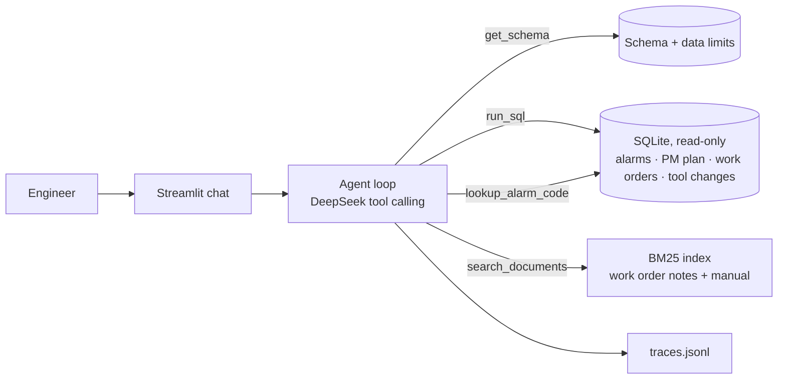

# CNC alarm triage agent

An LLM agent that helps maintenance engineers work out **why** CNC machine alarms keep recurring. It answers plain-language questions by querying alarm logs, preventive maintenance plans, tool change records and mixed English/Chinese work order notes, and it cites the records behind every claim.

> **Demo:** _add Space URL_ · **2-min walkthrough:** _add video link_

 <!-- TODO: add after deploying -->

## The problem

Machining sites generate hundreds of alarms a month. Finding the root cause of a recurring one means cross-checking four systems by hand, so most recurring alarms get reset instead of investigated. The full framing is in [docs/customer_brief.md](docs/customer_brief.md).

Example questions it handles:

- *Why did M03 keep throwing spindle overheat alarms from late July?*
- *TL-201 tool wear alarms went up on M05 and M06. What changed?*
- *M01 最近一直出現 X 軸跟隨誤差，根本原因找到了嗎？*
- *On July 28 many machines alarmed at once. Was it a machine problem?*
- *What was M03's energy consumption in July?* → says the data doesn't record it, rather than guessing.

## How it works



The agent is a plain tool-use loop (`triage/agent.py`, ~60 lines of logic, no framework) with four tools:

| Tool | Why it exists |
|---|---|
| `run_sql` | Counting, grouping, before/after and machine-vs-machine comparisons. Read-only and guarded (see below). |
| `search_documents` | Free-text search over work order notes and the manual, filterable by machine and date. |
| `lookup_alarm_code` | Canonical meaning, causes and checks for an alarm code. |
| `get_schema` | Tells the model what each table means **and what data does not exist**, which is what lets it refuse unanswerable questions. |

The system prompt encodes a reliability engineer's RCA routine: quantify the pattern, compare against a baseline and a same-model control, look for what changed around the onset, check the manual, and consider common-mode causes.

## Data: synthetic, with planted faults

Real maintenance data is confidential, so `triage/generate_data.py` builds a plant (8 machines, 2 sites, June–August 2026, ~1,000 alarms, ~180 work orders) with realistic background noise and four planted scenarios. Planting them gives **ground truth**, so the eval can check that the agent finds the actual cause, not a plausible one.

| | Scenario | What the agent has to find |
|---|---|---|
| S1 | M03 spindle overheat (SP-101) and low coolant pressure (CL-302) rise from mid-July | Coolant pump filter PM planned 7/10 was deferred for a rush order; done on 8/12, alarms stop after |
| S2 | Tool wear alarms (TL-201) roughly triple on M05, M06 from 7/20 | Insert supplier switched to ToolMax. M08 is the same model on the old supplier and is unaffected (the control) |
| S3 | M01 X-axis following error (AX-402) recurs for 7 weeks | Reset four times; the 5th work order finds a worn encoder cable. Nothing after the fix |
| S4 | Six machines alarm within 90 seconds on 7/28 | Site A utility voltage sag. Not a machine fault; Site B unaffected |

The notes are deliberately messy: mixed languages, shorthand, and many symptom-level entries ("reset OK", "復歸後正常") that bury the few informative ones.

## Evaluation

22 questions in `evals/questions.jsonl` across four categories: **lookup** (6), **aggregation** (6), **root cause** (6) and **unanswerable** (4), including three in Chinese.

Checks are deterministic. Expected numbers are computed from the database at eval time, so the eval stays valid if the data changes. Root-cause answers are checked for the key facts and for citing at least one of the right record IDs. Known blind spots are documented in `evals/checks.py`.

```bash
python -m evals.run_eval --tag baseline
python -m evals.compare evals/results/<before>.json evals/results/<after>.json
```

### Results

<!-- TODO: fill in from your runs -->
| Run | Lookup | Aggregation | Root cause | Unanswerable | Evidence cited | Tools / question |
|---|---|---|---|---|---|---|
| baseline | –/6 | –/6 | –/6 | –/4 | – | – |
| after iteration | –/6 | –/6 | –/6 | –/4 | – | – |

**What failed and what I changed:** _write up the 2–3 most instructive failures and the fix for each, with before/after._

## Decisions and trade-offs

**SQL tool instead of fixed metric functions.** A generic `run_sql` lets the agent answer questions nobody anticipated, which is most of RCA. The risk is that the query text comes from a model, so it has three layers of protection: statement validation (single SELECT, no write/DDL/PRAGMA/ATTACH, checked outside string literals), a read-only SQLite connection underneath, and a timeout plus row cap. Errors go back to the model as text so it can fix its own query.

**BM25 instead of embeddings, for now.** The notes are full of exact tokens that matter (CL-302, APKT1604, TM-2607), and lexical search handles those well. CJK text is indexed as character unigrams and bigrams, so 濾網堵塞 matches 濾網 without a word segmenter. No vector database, index builds in milliseconds. Hybrid retrieval is the next step if the eval shows semantic misses.

**No agent framework.** The loop is short enough to read in one sitting, every step lands in the trace, and there is nothing between the code and the API to debug.

**Step limit with a forced answer.** After `TRIAGE_MAX_STEPS` tool calls the agent must answer with what it has and say what is unverified, rather than looping or failing silently.

**Deterministic eval before LLM-as-judge.** Cheap, reproducible and easy to reason about. The cost is brittleness to phrasing, so failures get read by hand.

## Taking it to production

What a real deployment would need, roughly in priority order:

1. **Live data instead of snapshots.** Stream alarms from the machine monitoring system (e.g. via Kafka) into the query store, and sync work orders from the CMMS. The pipeline has to handle late and duplicated events and clock drift between machines.
2. **Access control and audit.** Per-site permissions on what an engineer can query, and a log of every question, query and answer.
3. **Human in the loop.** The output is a draft analysis. Any action (creating a work order, changing a PM interval) goes through the engineer.
4. **Evaluation on real cases.** Replace synthetic scenarios with past incidents whose root cause is known, and keep adding every case the tool gets wrong.
5. **Cost and latency.** Cache schema and manual lookups, pre-aggregate common views (alarms per machine per day), route simple lookups to a smaller model.

## Run it

```bash
pip install -r requirements.txt
python -m triage.generate_data          # builds data/plant.db, CSVs and manual
$env:TRIAGE_API_KEY="..."                # PowerShell; set your TokenPapa API key
$env:TRIAGE_BASE_URL="https://tokenpapa.ai/v1"
# The default model is deepseek-v4-flash; DeepSeek currently routes this legacy name to V4.1-Flash.
python -m triage.agent "Why does M03 keep throwing SP-101?"   # CLI
streamlit run app.py                                          # UI
python -m unittest                                            # tests, no API key needed
```

Docker (also works as a Hugging Face Docker Space, port 7860):

```bash
docker build -t cnc-triage .
docker run -p 7860:7860 -e TRIAGE_API_KEY=$TRIAGE_API_KEY -e TRIAGE_BASE_URL=https://tokenpapa.ai/v1 cnc-triage
```

For a Hugging Face Space, create a Docker Space, add `TRIAGE_API_KEY` as a secret and set `TRIAGE_BASE_URL` to `https://tokenpapa.ai/v1`, then put this header at the top of the Space's README:

```yaml
---
title: CNC Alarm Triage
sdk: docker
app_port: 7860
---
```

## Layout

```
triage/
  generate_data.py   synthetic plant + planted scenarios
  db.py              read-only SQL with guardrails
  retrieval.py       BM25 over work orders and manual (CJK-aware)
  tools.py           tool specs and executor
  agent.py           tool-use loop, tracing, CLI
evals/
  questions.jsonl    22 questions with checks
  checks.py          deterministic graders
  run_eval.py        runner; compare.py diffs two runs
tests/               offline tests: planted scenarios, SQL guard, retrieval, agent loop (fake client)
app.py               Streamlit UI
docs/customer_brief.md
```
